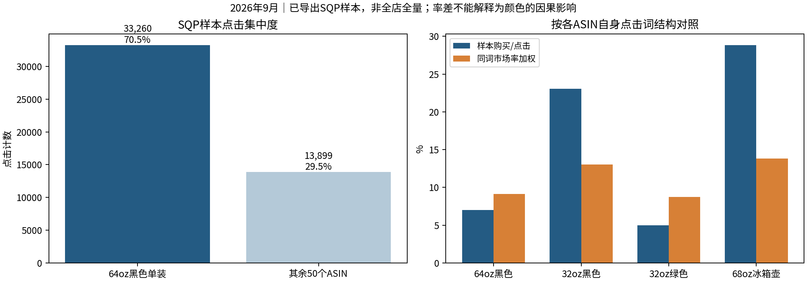
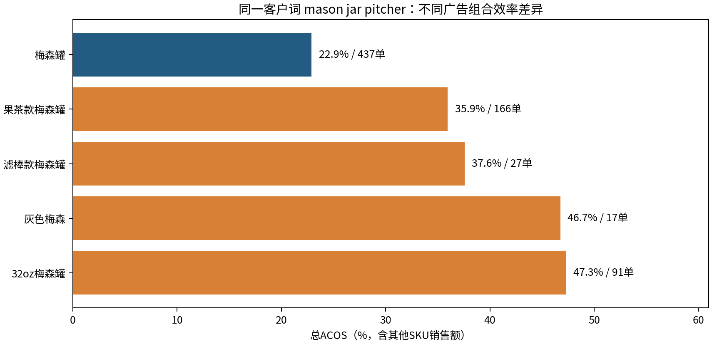
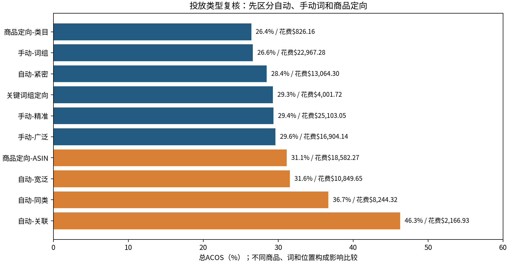
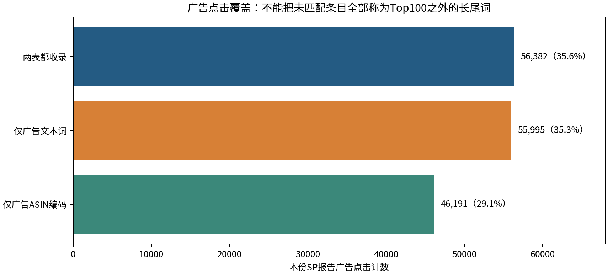

# 2026年9月亚马逊搜索与广告分析

分析人：独立复核原始文件；供与带教 zhenxiaocheng 讨论。范围：美国站广告、51个ASIN的SQP导出样本。广告金额均为USD。

## 先看结论

本报告直接从raw_data中的51个SQP CSV、广告原表和商品对应关系重新计算，围绕商品承接、广告降本与增长测试展开。当前数据适合回答：哪些商品的搜索承接值得优先检查、哪些词与商品组合投得有效、哪些投放单元应复核成本。当前数据无法可靠回答自然流量占比、广告增量贡献或净利润。

1. **先优化主力商品的承接。** B0DGCVK1JL（64oz黑色单装梅森罐）占SQP样本70.5%的点击、61.9%的购买计数。同词结构对照后，购买效率指数为0.77，优先检查它获得的流量是否适配商品，以及页面承接是否充分。
2. **按“搜索词×广告组合×投放单元”做决策。** `mason jar pitcher`在【梅森罐】组合的ACOS为22.9%，在【32oz梅森罐】为47.3%。同词好坏取决于落地商品、投放方式和成本，不能全店统一加价或否词。
3. **降本先看有体量的低效投放。** 自动关联整体ACOS46.3%，自动同类36.7%；【梅森罐】一条同类单元花费$3,654.70、ACOS41.9%。先拆具体目标，避免按整个类型删除。
4. **总ACOS需要结合SKU销售结构。** 全表花费$122,725.96、7天归因销售额$412,829.06，总ACOS29.7%。其他SKU销售额占44.0%，花费÷广告SKU销售额为53.1%；这不是利润亏损结论，也不是把其他SKU销售额判为无价值。
5. **增长候选可以测试，不能直接预测收益。** 105个组合×词候选满足“≥10单、ACOS≤25%”；例如【梅森罐】的`pitcher`、`glass pitcher with lid`。先确定利润和库存、是否受预算限制，再小步测试。

## 1. 数据能说明什么

| 数据 | 已验证范围 | 适合回答的问题 | 主要限制 |
| --- | --- | --- | --- |
| 51个SQP CSV | 3,117行、2,410个去重词；27个文件达到100行，排名1—100 | 指定词的市场规模、样本ASIN表现、点击与购买承接 | 前100导出；不足100行也不证明全量；不能代表所有搜索或全店 |
| 26.9.xlsx | 61,169行、43,846个归一化客户词、1,515个活动、20个组合 | 本份SP报告的广告花费、归因销售额、投放效率 | 无可靠推广ASIN/SKU字段；每行有覆盖日期区间；含商品编码条目 |
| 对应关系.xlsx | 72个非空且唯一ASIN；其中51个有SQP、21个未导出 | 识别商品、颜色、规格 | 不能证明广告范围仅为这72个ASIN，也不能证明所有都在售 |

“SQP包含自然和广告搜索表现”不等于“这份SQP导出是这份广告报告的总体”。Top100限制的是每个ASIN的查询排名，不是把整个市场按搜索量取前100。词出现在ASIN A的CSV里，也不意味着这个词在ASIN B的记录完整。

原始客户词43,847个，仅将大小写、首尾空格与连续空白统一后变成43,846个；不合并单复数、不同语言和不同拼写。市场计数对相同词完全一致，因此全局只计一次。ASIN计数在已导出ASIN×词范围内求和，称为“样本计数”，不称“完整品牌总量”。

## 2. 数据质量与证据边界

全部跨日期广告行有11,646行、花费$87,876.68，占71.6%。例如开始9月1日、结束9月30日的346行合计花费$41,681.05，这些是覆盖区间计数，不能当作9月1日的发生额。当前不做每日趋势，也不只剔除跨日期行或平均分摊到每天。月度合计用于本份报告的效率分析；完整性仍应与后台同范围月度汇总对账。

| 证据层级 | 依据 | 例子 | 解释边界 |
| --- | --- | --- | --- |
| 已验证事实 | 从原始计数汇总、同词匹配和计算校验得到 | 花费、销售额、点击、购买计数、ACOS、日期区间、词条覆盖 | 可以复算，不等于因果或完整店铺规模。 |
| 诊断线索 | 原始计数基础上构造描述性对照 | 同词购买率差异、结构调整购买指数、机会矩阵 | 用于排序检查；不确定原因，不表示统计显著。 |
| 待验证建议 | 筛选规则与业务判断 | 增长候选、高成本复核候选、调价或预算测试 | 25%/40%只是筛选线，未提供目标ACOS与利润，不能作为盈亏或收益承诺。 |
| 当前不能确定 | 缺少对齐口径或直接证据 | 自然流量占比、广告增量、净利润、页面因素的因果影响、计数加噪 | 不把脱敏等推测当成差异原因；补充官方定义和业务数据后再判断。 |

**精度问题：** 原始ASIN份额与直接计数相除的差均在0.005个百分点内，符合百分比保留两位小数。不能因为“总量×显示份额”反推时有误差，就断言原始整数计数被脱敏。价格有9行出现约6万至9万的异常值，本次不用于价格分析，也不凭猜测修正。

## 3. SQP：先识别商品承接与相关性

### 3.1 主力商品决定优化优先级

SQP样本共3,416,240曝光、47,159点击、16,730加购、3,778购买计数。整体购买/点击为8.0%。购买计数为ASIN口径，跨ASIN求和不等于独立买家数或去重订单笔数。

| ASIN | 品名 | 样本点击 | 样本购买 | 点击后购买率 | 结构调整购买指数 |
| --- | --- | --- | --- | --- | --- |
| B0DGCVK1JL | 梅森罐64oz（单装）黑色 | 33260 | 2339 | 7.0% | 0.77倍 |
| B0FVFFGLXY | 梅森罐32oz（单装）黑色 | 581 | 134 | 23.1% | 1.77倍 |
| B0FVFF4CP9 | 梅森罐32oz（单装）绿色 | 2434 | 121 | 5.0% | 0.57倍 |
| B0FP2FMCW1 | 68o水升（冰箱款） | 416 | 120 | 28.8% | 2.08倍 |
| B0DHCBQSZN | 糖罐6件套1.1 | 768 | 95 | 12.4% | 1.11倍 |
| B0F41X6T3G | 梅森罐64oz（单装）绿色-果茶款 | 790 | 94 | 11.9% | 1.13倍 |
| B0F42CD7BZ | 梅森罐64oz（单装）绿色-滤棒款 | 796 | 85 | 10.7% | 1.05倍 |
| B0F42HC931 | 梅森罐64oz（单装）黑色-滤棒款 | 794 | 82 | 10.3% | 0.94倍 |

“结构调整购买指数”=实际样本购买÷Σ（每词样本点击×同词市场购买/市场点击）。例如0.77表示按该ASIN已观察到的点击词结构与同词市场率对照，实际购买计数约为基准的77%。它减少了不同ASIN词结构差异的影响，但不控制价格、广告位置、库存、流量人群等差异；不代表颜色导致差异，也不是显著性或因果结论。

64oz黑色值得优先检查，是因为它体量大、影响面广。32oz黑色581点击134购买，购买/点击23.1%；绿色2,434点击121购买，为5.0%。结构调整后两者指数仍为1.77与0.57，值得检查词结构以外的库存、价格、评价、页面、广告位置等因素。不能只凭这两份表认定黑色比绿色更受欢迎。

### 3.2 大词不一定值得扩大投入

| 搜索词 | 样本点击 | 样本购买 | 样本点击后购买率 | 市场点击后购买率 |
| --- | --- | --- | --- | --- |
| kitchen | 2205 | 22 | 1.0% | 1.2% |
| mason jars | 1549 | 60 | 3.9% | 12.4% |
| home | 1385 | 11 | 0.8% | 0.7% |
| cold brew pitcher | 1181 | 69 | 5.8% | 12.0% |
| glass water bottles | 628 | 13 | 2.1% | 6.2% |
| mason jar | 550 | 31 | 5.6% | 15.2% |

`kitchen`有2,205样本点击但仅22购买，购买/点击约1.0%；`home`为0.8%。市场本身这类词的购买率也低，因此不能单凭低购买率判定商品页面有问题，也不能因为曝光或点击大就优先投放。原数据没有分出自然点击，不能将这些词定性为“自然大词”。

更值得诊断的是`mason jars`：样本购买/点击3.9%，同词市场12.4%；`cold brew pitcher`为5.8%对12.0%。其中64oz黑色在`mason jars`为1,465点击、57购买，原CSV第62行；在`cold brew pitcher`为960点击、50购买，原CSV第79行。先判断用户想要普通储存罐还是带把手倒水壶、想要冷萃功能是否满足，再查页面承接。没有页面与库存数据，不能确定具体原因。

诊断表里的“距市场率购买差额”用于排序检查顺序；市场竞争商品不同，不能把差额当成可挽回订单或收入承诺。

### 3.3 适配词和商品的增长线索

`glass carafe with lid`市场搜索量8,849，样本145点击、21购买，购买/点击14.5%，同词市场10.6%，样本购买份额4.94%。其中64oz黑色B0DGCVK1JL贡献144点击、21购买（原CSV第63行）。它是一个需商品形态核查的小额测试候选：确认是否符合carafe、带盖等意图后，再测试文案或精准词覆盖。不能将一个月145点击的结果当成稳定增长预测。

样本总体按自身点击词结构加权的市场购买率为9.4%，实际为8.0%，指数0.85。这个对照提示承接值得进一步拆解，不表示整体“少卖了多少订单”。更不能把不同ASIN行的市场总量相加当作全市场规模。

## 4. 广告：先看结构，再看具体词与投放单元

### 4.1 广告整体效率

| 指标 | 9月本份广告报告合计 |
| --- | --- |
| 曝光 / 点击 | 8,039,471 / 158,568 |
| 花费 / 7天归因销售额 | $122,725.96 / $412,829.06 |
| 广告归因订单 / 销量 | 16,016 / 16,571 |
| CTR / CPC / 订单每点击 | 1.97% / $0.77 / 10.10% |
| 总ACOS / ROAS | 29.73% / 3.36 |
| 广告SKU / 其他SKU归因销售额 | $231,125.83 / $181,703.23 |
| 其他SKU销售额占比 | 44.01% |

所有比率均用合计分子÷合计分母，未平均原表逐行比率。零销售额时ACOS留空，不填成0。

ACOS29.7%仅意味着每$100归因销售额对应约$29.7广告花费，是否盈利取决于广告前的贡献利润率：销售收入扣除商品成本、平台佣金、履约、物流、优惠等之后的利润率。退款等也应按业务口径纳入。未提供成本数据，因此不下“盈利/亏损”判断。归因销售额也不等于广告带来的增量销售。

广告花费÷广告SKU销售额为53.1%。这个对照显示对其他SKU归因收入依赖较高，不是亚马逊标准总ACOS的替代指标，不代表其他SKU收益应该忽略；“其他SKU”也不一定是另一条产品线，可能含同款变体。当前表无法确认具体售出商品及是否增量。

### 4.2 广告组合的优先级

| 广告组合名称 | 广告花费 | 广告销售额 | 广告订单 | ACOS | 其他SKU销售额占比 |
| --- | --- | --- | --- | --- | --- |
| 【梅森罐】 | $81,777.67 | $287,633.24 | 11369 | 28.4% | 44.3% |
| 【32oz梅森罐】 | $12,363.00 | $37,471.67 | 1671 | 33.0% | 57.0% |
| 【果茶款梅森罐】 | $5,808.10 | $15,577.47 | 657 | 37.3% | 56.4% |
| 【滤棒款梅森罐】 | $4,401.51 | $11,046.64 | 466 | 39.8% | 40.2% |
| 【饮品罐】 | $3,900.34 | $14,798.17 | 257 | 26.4% | 36.1% |
| 【水升】 | $2,738.34 | $7,273.70 | 275 | 37.6% | 24.0% |
| 【洗衣液分配器】 | $2,716.67 | $9,450.58 | 204 | 28.7% | 26.8% |
| 【店铺】低价扫流 | $2,046.70 | $6,817.82 | 251 | 30.0% | 38.5% |
| 【高硼硅梅森罐】 | $1,659.47 | $4,508.49 | 189 | 36.8% | 26.9% |
| 【糖罐B0DHWZMVVG】 | $1,622.03 | $4,920.76 | 164 | 33.0% | 25.3% |

【梅森罐】占花费66.6%、销售额69.7%，总ACOS28.4%，是最值得持续维护的主力组合。【32oz梅森罐】ACOS33.0%，其他SKU收入占57.0%；【果茶款梅森罐】ACOS37.3%，其他SKU占56.4%；应同时拆看成本和实际售出商品。组合名称只是后台分组，不自动等于某个ASIN或完整产品线。

### 4.3 同一词要看投给了什么商品

| 广告组合名称 | 广告花费 | 广告订单 | ACOS |
| --- | --- | --- | --- |
| 【梅森罐】 | $2,562.43 | 437 | 22.9% |
| 【果茶款梅森罐】 | $1,445.91 | 166 | 35.9% |
| 【滤棒款梅森罐】 | $236.99 | 27 | 37.6% |
| 【灰色梅森】 | $195.55 | 17 | 46.7% |
| 【32oz梅森罐】 | $987.97 | 91 | 47.3% |

`mason jar pitcher`在不同组合都出单，但成本明显不同。【梅森罐】22.9%可列增长测试，【32oz梅森罐】47.3%先列降本复核。建议先核对具体投放单元和推广商品，再考虑组合内小幅调整；不能由组合名直接判断原因是容量。

### 4.4 不要把所有“-”算自动广告

| 投放类型 | 广告花费 | 广告订单 | ACOS | 其他SKU销售额占比 |
| --- | --- | --- | --- | --- |
| 手动-精准 | $25,103.05 | 3336 | 29.4% | 44.7% |
| 手动-词组 | $22,967.28 | 3270 | 26.6% | 45.2% |
| 商品定向-ASIN | $18,582.27 | 2321 | 31.1% | 42.2% |
| 手动-广泛 | $16,904.14 | 2180 | 29.6% | 42.5% |
| 自动-紧密 | $13,064.30 | 1881 | 28.4% | 41.6% |
| 自动-宽泛 | $10,849.65 | 1325 | 31.6% | 40.5% |
| 自动-同类 | $8,244.32 | 902 | 36.7% | 47.1% |
| 关键词组定向 | $4,001.72 | 546 | 29.3% | 51.1% |
| 自动-关联 | $2,166.93 | 170 | 46.3% | 62.7% |
| 商品定向-类目 | $826.16 | 85 | 26.4% | 47.8% |

四类自动通过投放字段识别；“-”还包含商品ASIN定位、类目与关键词组定向。自动关联ACOS46.3%、其他SKU收入占62.7%，自动同类36.7%，优先查看具体单元。手动词组26.6%低于精准29.4%，但商品和词构成不同，不能得出“词组优于精准”的普遍规则。

具体有体量的问题单元：

- 【梅森罐】低价扫流0.7 -2 - z，`substitutes`：$3,654.70、346单、ACOS41.9%。先拆客户ASIN与推广商品，再决定哪部分调整。
- 【32oz梅森罐】低价扫流0.7 - z，`complements`：$944.69、77单、ACOS53.3%。先核对关联商品和连带利润，再小步测试成本。

### 4.5 零单花费不能全部叫浪费

原始行中零单花费$50,472.72；同词在其他行可能有成交。按“广告组合×客户词”汇总后，整个组合词仍零单的花费为$45,025.65，大量来自一两次点击的条目。按“≥20点击、≥$20且零单”筛选仅26个组合词、$702.04，占全部花费0.57%。因此直接声称可以节省$50,472.72没有依据。

| 广告组合名称 | 搜索词 | 广告点击 | 广告花费 |
| --- | --- | --- | --- |
| 【梅森罐】 | b0bbknw9bz | 55 | $42.53 |
| 【梅森罐】 | infusion pitcher | 35 | $40.56 |
| 【饮品罐】 | juice dispenser | 91 | $36.90 |
| 【果茶款梅森罐】 | wedding registry items | 57 | $36.38 |
| 【梅森罐】 | xarfxco cold brew pitcher | 38 | $35.17 |
| 【店铺】低价扫流 | wedding registry items | 117 | $35.16 |
| 【梅森罐】 | b0bs8ztqfl | 45 | $33.20 |
| 【32oz梅森罐】 | tupperware | 52 | $28.48 |

20点击零单只是复核阈值：如果真实购买率10%，20点击仍零单的概率约12%。核对归因是否成熟、相关性和具体投放单元后才考虑否定；文本词与商品编码分别处理，不能把整个店铺都否掉。

### 4.6 有单高成本与增长候选

复核筛选：≥5单、花费≥$50且ACOS>40%，共45个组合词、$6,945.61花费，均有成交，适合检查成本和利润，不适合直接暂停。

| 广告组合名称 | 搜索词 | 广告花费 | 广告订单 | ACOS |
| --- | --- | --- | --- | --- |
| 【32oz梅森罐】 | mason jar pitcher | $987.97 | 91 | 47.3% |
| 【滤棒款梅森罐】 | cold brew coffee maker | $540.65 | 52 | 43.8% |
| 【水升】 | glass pitchers with handle and lid | $306.26 | 22 | 51.6% |
| 【高硼硅梅森罐】 | glass pitcher with lid | $250.56 | 21 | 48.4% |
| 【32oz梅森罐】 | small glass pitcher | $211.19 | 20 | 49.8% |
| 【滤棒款梅森罐】 | cold brew maker | $197.84 | 10 | 86.1% |

增长筛选：≥10单且ACOS≤25%，共105个组合词，合计花费$18,854.22、归因销售额$91,354.01、3,625单。25%和40%是本次用于筛选的观察线，用户暂未提供业务目标，不能当作统一盈亏标准。

| 广告组合名称 | 搜索词 | 广告花费 | 广告订单 | ACOS |
| --- | --- | --- | --- | --- |
| 【梅森罐】 | mason jar pitcher | $2,562.43 | 437 | 22.9% |
| 【梅森罐】 | glass pitcher with lid | $2,476.39 | 401 | 24.3% |
| 【梅森罐】 | pitcher | $2,455.29 | 425 | 23.2% |
| 【梅森罐】 | tea pitcher | $657.19 | 114 | 23.3% |
| 【滤棒款梅森罐】 | spreccio mason jar pitcher | $454.26 | 80 | 22.8% |
| 【梅森罐】 | sun tea glass jar for outside | $430.70 | 84 | 20.3% |

具体可讨论的投放单元：【梅森罐】手动精准核心1 mason jar pitcher，花费$2,131.72、374单、ACOS22.3%；以及【梅森罐】手动广泛 glass pitchers with handle and lid - z，$4,029.91、633单、23.6%。先看推广商品、预算是否受限、库存和目标ACOS；预算受限才试加预算，避免因为历史效率好就机械加价。更高预算的边际成本可能上升。

## 5. 两表对照：为什么“全量小于纯广告”

| 集合 | 词条数 | SQP样本点击 | 广告点击 | 广告点击占全表 |
| --- | --- | --- | --- | --- |
| 两表都收录 | 1,802 | 46,005 | 56,382 | 35.56% |
| 仅SQP收录 | 608 | 1,154 | 未匹配到 | — |
| 仅广告收录 | 42,044 | 未匹配到 | 102,186 | 64.44% |

1,802+608=2,410个SQP词；1,802+42,044=43,846个广告词；并集44,454个。以双方是否出现做集合统计，与双方是否有正点击分开。1,776个双方有点击只是交集子集，另外26个共有词在SQP样本中零点击。

仅广告收录的42,044条中，10,681条是ASIN编码，贡献46,191点击；31,363条是文本词，贡献55,995点击。编码条目不宜解释为普通客户输入的“长尾词”，是否发生在详情页或其他位置仍需广告报告确认。文本词也可能来自未导出商品，不能把全部缺失都归因于Top100。

即使只看共有词，广告点击56,382仍大于SQP样本46,005，说明按词取交集仍未解决ASIN与场景范围差异。广告销售包含其他SKU、购买归因时间规则也需对齐。因此不计算自然点击、自然购买或广告占比；广告≤SQP时也不使用相减。仅SQP出现也只表示本份SP报告未匹配到，不意味着完全没广告。

## 6. 给带教的执行建议与下一步数据

### 第一步：先校准口径和主力商品

本次以可复算的月度总数和原始SQP记录为基础；日度趋势与自然流量拆分需补齐口径后再评估。核对64oz黑色的`mason jars`与`cold brew pitcher`搜索意图、页面、库存和实际投放商品。补充广告前贡献利润率及不同SKU毛利，建立各商品合理目标ACOS。

### 第二步：降本和增长分别做小步测试

降本从上述同类/关联单元、45个有单高ACOS组合词里选择少量具体对象；增长从105个候选中选择库存充足、利润符合要求且受预算约束的对象。作为讨论方案，单次出价可试降10%—15%、预算可试增10%，每次只调整一个变量。这些幅度不是对全部单元的执行指令。

记录修改日期、原设置、商品、目标、预期观察指标。先观察7天点击发生数据，再等待7天归因窗口及后台更新充分成熟后比较；需覆盖可比星期结构，避免同时更改价格、图片或优惠。观察ACOS、订单/日、广告SKU与其他SKU收入、全店或商品总销量，不只看单一广告比例。低点击测试延长观察，不机械按7天结束。

### 第三步：把补数据请求写具体

- SQP：同市场、同月份、同ASIN范围，申请后台当前权限允许导出的更多词；如能取品牌视图，保留品牌字段及完整指标说明。不要预设一定能导出1,000条。
- 广告：重新导出明确日粒度SP报告；另取推广商品报告，将活动/广告组与推广ASIN、SKU、售出商品建立可靠关系。若广告组含多个商品，不能只凭广告组名称硬分摊搜索词指标。
- 商品经营：广告前贡献利润率、库存与断货记录、价格和优惠、评论变化、Business Reports商品销售与Sessions、其他月份同口径数据。
- 归因说明：保留当前后台SQP购买定义、广告7天窗口、更新日期和报告设置截图，再决定可比较范围。补充SB/SD是否存在，不能默认本份SP就是所有广告。

## 7. 文件和复算方式

优先阅读《给带教的汇报稿.md》，核对时打开《9月独立分析.xlsx》。完整CSV包括全部51,736条组合词汇总、43,846条广告客户词汇总和44,454条两表对照，没有为了美观删除低点击词。工作簿只放与SQP相关的2,410条对照和176条行动候选，其余见同目录CSV。

SQP明细保留来源文件与原始行号；广告组合词汇总保留原始Excel行号和日期范围。原始行号首末只用于定位范围，不代表中间行均匹配。原始文件SHA-256记录于source_manifest.json。

复算：在项目根目录运行 `python analysis/analyze.py`，再运行 `python analysis/build_deliverables.py`。只读取原始CSV/XLSX，不读取其他分析文件作为数据来源，不改变原始压缩包或raw_data。

## 8. 搜索机会矩阵与使用场景

点击吸引力指数＝样本点击/样本曝光 ÷ 同词市场点击/市场曝光；购买承接指数＝样本购买/样本点击 ÷ 同词市场购买/市场点击。以1倍作为描述性分界，低于100点击先标为样本不足。这个矩阵用于检查顺序，不是显著性检验，不识别自然流量，也不证明页面因素导致差异。

| 点击吸引力 | 购买承接 | 优先检查 |
| --- | --- | --- |
| 达基准 | 达基准 | 相关性、绝对购买率、利润、库存和预算约束，之后考虑维护或增长测试 |
| 达基准 | 偏低 | 规格和词意图、价格、页面、库存、评价、流量位置 |
| 偏低 | 达基准 | 主图、展示位置、标题、价格和竞品构成 |
| 偏低 | 偏低 | 商品与词意图是否适配，避免只因市场词大就买量 |

场景线索：sun tea glass jar for outside的吸引力指数1.47、承接指数1.14，【梅森罐】广告ACOS20.3%；tea pitcher for fridge分别为1.48、1.15与19.6%。可以结合商品实际支持的容量、盖子、把手、倒水方式考虑小额增长测试。

iced tea pitcher的SQP两项指数也较强，但【梅森罐】广告ACOS31.2%，先看利润与成本。glass carafe with lid承接指数1.37、吸引力0.88、广告ACOS13.3%，可先研究点击环节；只有145个SQP样本点击，仍需验证稳定性。上述两表范围未完全对齐，不将广告表现归到某个具体ASIN，也不推算自然流量。

7月工作文件仅提供分析组织方式参考，其数值、第三方排名、竞价与公式没有作为9月指标来源。矩阵和场景判断均用9月原始数据重新计算。
